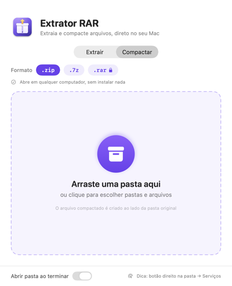
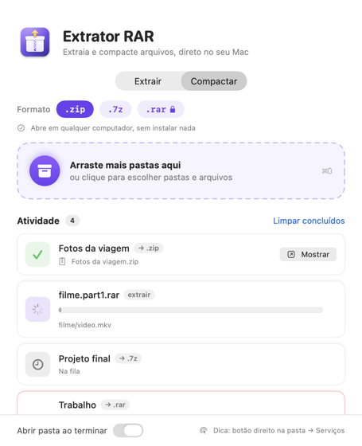

<p align="center">
  
</p>

<h1 align="center">Extrator RAR para macOS</h1>

<p align="center">
  Abra arquivos <code>.rar</code> e compacte suas pastas no Mac, sem WinRAR: arraste, solte e pronto.<br>
  
  
</p>

<p align="center">
  <a href="https://github.com/BrenoRocha1/extrator-de-.rar-para-mac/releases/latest/download/Extrator-RAR.dmg">
    
  </a>
</p>

O macOS não vem com o WinRAR e não abre arquivos `.rar` sozinho. Este projeto é um app nativo, pequeno e gratuito, que resolve isso:

- **Extrair:** arraste um `.rar` (ou `.zip`, `.7z`, `.tar`, `.gz`…) para a janela e ele é aberto numa pasta.
- **Compactar:** arraste uma pasta e ela vira um `.zip`, `.7z` ou `.rar`. Também dá para fazer pelo botão direito do mouse, direto no Finder.

<p align="center">
  
  
  
</p>

---

## Funcionalidades

### Extrair

- **Arrastar e soltar**: solte um ou vários arquivos na janela.
- **Clique para escolher** (ou `⌘O`): clicar na área de soltar abre uma janela de seleção de arquivos.
- **Layout que se adapta**: sem arquivos, a área de soltar ocupa a janela; quando a extração começa, ela vira uma barra compacta e a lista ganha o espaço. A janela pode ser redimensionada e funciona no modo claro e no escuro.
- **Integração com o Finder**: o app aparece em *Abrir com* quando você clica com o botão direito num `.rar`.
- **Fila de extração**: os arquivos são extraídos um de cada vez, e cada um mostra seu status (na fila, extraindo, concluído ou erro).
- **Progresso ao vivo**: mostra o nome do arquivo que está sendo extraído naquele momento.
- **Pasta automática**: o conteúdo vai para uma pasta com o mesmo nome do arquivo, criada ao lado dele. Se a pasta já existir, cria `nome 2`, `nome 3` e assim por diante, sem sobrescrever nada.
- **Abre a pasta no Finder ao terminar** (dá para desligar na janela).
- **RAR com senha e RAR em várias partes**: funcionam se a ferramenta [`unar`](https://theunarchiver.com/command-line) estiver instalada. O app pede a senha numa janela.
- **Não depende de nada para o uso básico**: usa o `bsdtar`, que já vem instalado no macOS.

### Compactar

- **Transforme uma pasta em arquivo compactado**: arraste a pasta para a aba **Compactar** e escolha o formato.
- **Três formatos**:

  | Formato | Quando usar | Precisa instalar algo? |
  |---|---|---|
  | `.zip` (padrão) | Para mandar para qualquer pessoa: abre em Mac, Windows e celular | Não |
  | `.7z` | Para ocupar menos espaço | Não (quem recebe precisa do 7-Zip ou similar) |
  | `.rar` | Quando alguém pede especificamente um `.rar` | Sim, o programa oficial `rar` ([veja como](#opcional-criar-arquivos-rar)) |

- **Botão direito no Finder**: clique com o botão direito numa pasta → **Serviços** → **Compactar com Extrator RAR**. Nem precisa abrir o app antes.
- **Arquivo criado ao lado da pasta**: `Fotos` vira `Fotos.zip`, na mesma pasta. Se já existir, cria `Fotos 2.zip`, sem sobrescrever nada.
- **Sem lixo do Mac**: os arquivos ocultos `.DS_Store` e a pasta `__MACOSX` não entram no arquivo, então ele fica limpo para quem usa Windows.
- **Lembra o último formato** escolhido.

---

## Instalação

Existem duas formas de instalar. **Se você não mexe com programação, use a Opção 1.**

| | Opção 1: baixar o instalador | Opção 2: compilar o código |
|---|---|---|
| Para quem | Qualquer pessoa | Quem quer ver ou mudar o código |
| Precisa de Terminal? | Não | Sim |
| Precisa instalar algo antes? | Não | Xcode Command Line Tools |
| Tempo | 1 minuto | 5 minutos |

Requisito das duas: **macOS 14 (Sonoma) ou mais novo**, em Mac com Apple Silicon (M1, M2, M3…) ou com Intel.

### Opção 1: baixar o instalador (mais fácil)

1. **Baixe o instalador:** [**Extrator-RAR.dmg**](https://github.com/BrenoRocha1/extrator-de-.rar-para-mac/releases/latest/download/Extrator-RAR.dmg)
   (ou acesse a página de [Releases](https://github.com/BrenoRocha1/extrator-de-.rar-para-mac/releases) e clique em `Extrator-RAR.dmg`).
2. **Abra o arquivo baixado.** Ele fica na pasta *Downloads*. Uma janela vai aparecer com o app e um atalho para a pasta **Aplicativos**.
3. **Arraste o Extrator RAR para a pasta Aplicativos**, dentro dessa mesma janela.
4. **Abra o app pela primeira vez** (veja o aviso abaixo).
5. Pronto. Pode ejetar o "Extrator RAR" que apareceu na barra lateral do Finder e apagar o `.dmg`.

#### ⚠️ Aviso na primeira vez que abrir

O app é gratuito e não foi publicado na App Store, então o macOS mostra um aviso parecido com *"Não foi possível verificar o app"*. Isso é normal e só acontece uma vez. Para liberar:

**No macOS 15 (Sequoia) ou mais novo:**
1. Tente abrir o app e clique em **OK** (ou **Concluído**) no aviso.
2. Abra **Ajustes do Sistema** → **Privacidade e Segurança**.
3. Role até o fim da página e clique em **Abrir Mesmo Assim**, ao lado da mensagem sobre o Extrator RAR.
4. Confirme com sua senha do Mac e clique em **Abrir**.

**No macOS 14 (Sonoma):**
1. Na pasta Aplicativos, clique com o **botão direito** no Extrator RAR → **Abrir**.
2. No aviso, clique em **Abrir**.

<details>
<summary>Prefere usar o Terminal? Clique aqui</summary>

Este comando remove a marca de "baixado da internet" do app, e o aviso não aparece mais:

```bash
xattr -dr com.apple.quarantine "/Applications/Extrator RAR.app"
```

</details>

### Opção 2: compilar o código

1. Instale as ferramentas de desenvolvedor da Apple (traz o compilador `swiftc`):

```bash
xcode-select --install
```

2. Baixe o código e compile:

```bash
git clone https://github.com/BrenoRocha1/extrator-de-.rar-para-mac.git
cd extrator-de-.rar-para-mac
./build.sh
```

3. Copie o app gerado para a pasta Aplicativos:

```bash
ditto "Extrator RAR.app" "/Applications/Extrator RAR.app"
```

Como o app foi compilado no seu próprio Mac, o aviso da primeira abertura não aparece.

### (Opcional) Suporte a senha e a arquivos divididos em partes

Vale para as duas opções. Se você tem o [Homebrew](https://brew.sh), rode no Terminal:

```bash
brew install unar
```

### (Opcional) Criar arquivos .rar

**Extrair `.rar` funciona sem instalar nada.** Já para **criar** um `.rar`, é preciso o programa oficial `rar`. O formato RAR é fechado e pertence à RARLAB (a empresa do WinRAR): nenhum outro programa tem permissão para criar esses arquivos.

> 💡 Na dúvida, use `.zip`: abre em qualquer computador e não precisa de nada disso.

Para instalar o `rar`:

1. Acesse [rarlab.com/download.htm](https://www.rarlab.com/download.htm) e baixe o **RAR for macOS** (escolha *ARM* se o seu Mac tem chip M1/M2/M3…, ou *x64* se ele é Intel).
2. Dê dois cliques no arquivo baixado (`rarmacos-….tar.gz`). Vai aparecer uma pasta `rar` em *Downloads*.
3. No Terminal, rode os comandos abaixo, um de cada vez (vai pedir a senha do Mac):

```bash
sudo mkdir -p /usr/local/bin
```

```bash
sudo install -m 755 ~/Downloads/rar/rar /usr/local/bin/rar
```

```bash
sudo xattr -d com.apple.quarantine /usr/local/bin/rar
```

4. Feche e abra o Extrator RAR. O cadeado do `.rar` some.

O `rar` é um programa *shareware* da RARLAB: dá para testar de graça, e a licença de uso contínuo é vendida por eles. O Homebrew deixou de distribuir o `rar` porque ele não passa na verificação de segurança do macOS (Gatekeeper), por isso a instalação é manual.

---

## Como usar

### Extrair um `.rar`

1. Abra o **Extrator RAR** (ele abre na aba **Extrair**).
2. Arraste um ou mais arquivos `.rar` para a área tracejada, ou clique nela para escolher os arquivos.
3. Espere o ✓ verde aparecer na lista. A pasta com os arquivos extraídos abre no Finder.

**Pelo Finder:** clique com o botão direito no `.rar` → **Abrir com** → **Extrator RAR**.

**Para abrir todos os `.rar` com ele no duplo clique:** selecione um `.rar`, aperte `⌘I`, escolha **Extrator RAR** em *Abrir com* e clique em **Alterar Tudo…**.

### Transformar uma pasta em `.zip`, `.7z` ou `.rar`

**Pelo app:**

1. Abra o **Extrator RAR** e clique na aba **Compactar**.
2. Escolha o formato: **.zip**, **.7z** ou **.rar**. Na dúvida, deixe **.zip**.
3. Arraste a pasta para a área tracejada, ou clique nela para escolher.
4. Espere o ✓ verde. O arquivo novo aparece ao lado da pasta original, e o Finder mostra onde ele está.

**Pelo botão direito (mais rápido):**

1. No Finder, clique com o **botão direito** na pasta.
2. Vá em **Serviços** → **Compactar com Extrator RAR**. Em alguns Macs, essa opção aparece em **Ações Rápidas**.
3. O app abre sozinho e cria o arquivo no último formato que você escolheu.

> Não achou a opção no menu? Abra o app uma vez depois de instalar, para o macOS registrar o serviço. Se ainda não aparecer, vá em **Ajustes do Sistema → Teclado → Atalhos de Teclado → Serviços → Arquivos e Pastas** e marque **Compactar com Extrator RAR**.

**Atalho:** arrastar uma **pasta** para a aba **Extrair** também funciona. O app percebe que é uma pasta e compacta em vez de extrair.

---

## Como funciona, passo a passo

### 1. O arquivo chega ao app

O arquivo (ou pasta) pode chegar por quatro caminhos:

| Origem | Onde no código | Modo |
|---|---|---|
| Arrastar para a janela | `DropZone` → `.onDrop` → `ContentView.handleDrop` | Automático na aba Extrair, compactar na aba Compactar |
| Clique na área de soltar ou `⌘O` | `ContentView.chooseFiles()` → `NSOpenPanel` | Extrair ou compactar, conforme a aba |
| Finder ("Abrir com", duplo clique, soltar no ícone do Dock) | `AppDelegate.application(_:open:)` | Automático |
| Botão direito → Serviços → "Compactar com Extrator RAR" | `FinderService.compressFiles` | Compactar |

Todos levam ao mesmo método: `Extractor.shared.enqueue(urls, mode:)`. No modo **automático**, o app decide sozinho o que fazer com cada item:

- **Pasta** → compacta.
- **Arquivo com extensão de arquivo compactado** (`.rar`, `.zip`, `.7z`, `.tar`, `.gz`…) → extrai.
- **Qualquer outro arquivo** → compacta.

O Finder só oferece o app em *Abrir com* porque o `Info.plist` declara, em `CFBundleDocumentTypes`, que o app sabe abrir arquivos compactados e pastas. Como o macOS não conhece o tipo `.rar` por padrão, o mesmo arquivo também declara esse tipo em `UTImportedTypeDeclarations`, com o identificador `com.rarlab.rar-archive`.

O item **Compactar com Extrator RAR** do menu de Serviços vem da chave `NSServices` do `Info.plist`. Ela diz ao macOS que o app recebe pastas e arquivos (`NSSendFileTypes`) pela mensagem `compressFiles`. Quando o app abre, o `AppDelegate` registra o `FinderService` como quem atende essa mensagem.

### 2. A fila

O `Extractor` guarda uma lista de `Job`s. Cada `Job` tem o item de origem, o tipo de tarefa (`extract` ou `compress` com o formato escolhido) e um status:

```
waiting (na fila) → running (trabalhando) → done (concluído) ou failed (erro)
```

O método `runNext()` pega o próximo job da fila e chama `extract` ou `compress`, conforme o tipo. Só um job roda por vez, o que evita vários processos competindo pelo disco. Quando um job termina, `runNext()` é chamado de novo para pegar o seguinte.

O trabalho roda em segundo plano (`Task.detached`), então a janela continua respondendo enquanto isso.

### 3. A pasta de destino

O método `uniqueURL(in:name:extension:)` escolhe um nome livre, ao lado do item original:

- `~/Downloads/filme.rar` → `~/Downloads/filme/`
- `~/Downloads/filme.part1.rar` → `~/Downloads/filme/` (o sufixo `.part1` é removido)
- Se `filme/` já existir, usa `filme 2/`, depois `filme 3/`, e assim por diante.
- Na compactação: `~/Documentos/Fotos/` → `~/Documentos/Fotos.zip`, e depois `Fotos 2.zip`, e assim por diante.

### 4. A extração com o `bsdtar` (padrão)

O macOS já vem com o `/usr/bin/bsdtar`, que usa a biblioteca **libarchive**. Essa biblioteca lê RAR4, RAR5, ZIP, 7z, TAR e outros formatos. O app executa:

```bash
/usr/bin/bsdtar -xvf "arquivo.rar" -C "pasta-destino"
```

- `-x`: extrai
- `-v`: escreve o nome de cada arquivo extraído (o app usa isso para mostrar o progresso)
- `-f`: indica o arquivo compactado
- `-C`: indica a pasta de destino

O método `run(_:_:progress:)` inicia o processo com `Process`, lê a saída linha por linha por um `Pipe` e envia a última linha para a interface. É por isso que o nome do arquivo atual aparece embaixo do nome do `.rar`.

### 5. Plano B: o `unar` (senha e arquivos em várias partes)

O `bsdtar` não abre RAR com senha nem RAR dividido em partes. Se ele falhar e o `unar` estiver instalado (o app procura em `/opt/homebrew/bin` e `/usr/local/bin`), o app tenta de novo com:

```bash
unar -force-overwrite -no-directory -output-directory "pasta-destino" "arquivo.rar"
```

Se a mensagem de erro mencionar `password`, o app mostra uma janela pedindo a senha (`askPassword`) e tenta mais uma vez com `-password`.

### 6. A compactação

O método `compress(_:as:progress:)` usa um programa diferente para cada formato:

**ZIP e 7Z**: o próprio `bsdtar` do macOS, sem instalar nada:

```bash
/usr/bin/bsdtar -c --format zip --exclude .DS_Store -v -f "Fotos.zip" -C "pasta-de-cima" "Fotos"
```

- `-c`: cria um arquivo novo
- `--format zip` (ou `7zip`): o formato do arquivo
- `--exclude .DS_Store`: deixa de fora os arquivos ocultos que o Finder cria
- `-C "pasta-de-cima" "Fotos"`: entra na pasta de cima e adiciona só `Fotos`. Assim, quem abrir o arquivo recebe uma pasta `Fotos/` e não o caminho inteiro do seu Mac (`/Users/voce/Documentos/...`).

**RAR**: o programa oficial `rar`, se estiver instalado em `/opt/homebrew/bin` ou `/usr/local/bin`:

```bash
rar a -r -ep1 "-x*.DS_Store" "Fotos.rar" "/caminho/até/Fotos"
```

- `a`: adiciona arquivos (cria o `.rar`)
- `-r`: inclui as subpastas
- `-ep1`: guarda os caminhos a partir de `Fotos/`, pelo mesmo motivo do `-C` acima
- `-x*.DS_Store`: deixa de fora os arquivos ocultos do Finder

Se o `rar` não estiver instalado, o formato aparece com um cadeado 🔒 e a tarefa termina com uma mensagem explicando como instalar, ou sugerindo usar `.zip`.

O progresso funciona como na extração: o `bsdtar` escreve `a arquivo` para cada item adicionado, e o `rar` escreve `Adding arquivo OK`. O método `fileName(fromLogLine:)` limpa essas linhas para mostrar só o nome do arquivo.

### 7. O resultado

- **Deu certo**: o status vira `done` e aparece o botão **Abrir** (extração) ou **Mostrar** (compactação). Se a opção estiver ligada, o Finder abre mostrando o resultado.
- **Deu errado**: o app apaga o que ficou pela metade (a pasta vazia ou o arquivo compactado incompleto) e mostra as últimas linhas do erro. Se o `unar` não estiver instalado, também sugere o `brew install unar`.

---

## Estrutura do projeto

```
.
├── Sources/
│   ├── ExtratorRAR.swift   # O app inteiro: interface (SwiftUI) + extração e compactação
│   └── MakeIcon.swift      # Desenha a logo do app (ícone .icns e assets/logo.png)
├── assets/                 # Logo e capturas de tela usadas neste README
├── Info.plist              # Metadados do app e tipos de arquivo que ele abre
├── build.sh                # Compila e monta o "Extrator RAR.app"
├── release.sh              # Gera o instalador Extrator-RAR.dmg
└── README.md
```

### `Sources/ExtratorRAR.swift`

| Parte | O que faz |
|---|---|
| `ExtratorRARApp` | Ponto de entrada do app (`@main`). Cria uma janela única. |
| `AppDelegate` | Recebe os arquivos abertos pelo Finder, registra o serviço do botão direito e fecha o app quando a janela é fechada. |
| `FinderService` | Atende o item "Compactar com Extrator RAR" do menu de Serviços do Finder. |
| `ArchiveFormat` | Os formatos de compactação (ZIP, 7Z, RAR), com a descrição de cada um e se ele está disponível neste Mac. |
| `Job` | Uma tarefa da fila: o item de origem, o tipo (extrair ou compactar) e o status. |
| `Extractor` | O motor do app: fila, modo automático, escolha do nome de destino, execução do `bsdtar`/`unar`/`rar`, pedido de senha. |
| `OutputBuffer` | Junta a saída do processo de forma segura entre threads. |
| `ContentView` | A janela: cabeçalho com a logo, abas Extrair/Compactar, área de soltar, lista de atividade e rodapé com as opções. |
| `FormatPicker` / `FormatChip` | A escolha de formato da aba Compactar. Mostra um cadeado no `.rar` quando o programa `rar` não está instalado. |
| `DropZone` | A área de soltar. Muda o texto e o ícone conforme a aba, fica grande quando a lista está vazia e vira uma barra compacta quando há tarefas. |
| `JobRow` | Um cartão da lista: ícone colorido pelo status, nome, etiqueta do tipo ("extrair" ou "→ .zip"), barra de progresso ou erro, e botão "Abrir"/"Mostrar". |

### `build.sh`

1. Apaga o `.app` anterior e cria a estrutura de pastas (`Contents/MacOS`, `Contents/Resources`).
2. Compila o Swift com `swiftc -O -parse-as-library` duas vezes, uma para Apple Silicon (`arm64`) e outra para Intel (`x86_64`), e junta as duas com o `lipo`. O resultado é um app "universal" que roda em qualquer Mac.
3. Copia o `Info.plist`.
4. Roda o `MakeIcon.swift`, que desenha a logo (caixa com zíper e seta saindo) em vários tamanhos, e converte o resultado para `.icns` com o `iconutil`.
5. Assina o app com uma assinatura local (`codesign --sign -`), que o macOS exige para rodar apps em Macs com Apple Silicon.

O projeto não usa Xcode nem `.xcodeproj`: basta o compilador de linha de comando.

### `release.sh` (para publicar uma nova versão)

Gera o `Extrator-RAR.dmg`, o instalador da Opção 1:

1. Roda o `build.sh` para gerar o app universal.
2. Monta uma pasta temporária com o app e um atalho chamado **Aplicativos** apontando para `/Applications`. É esse atalho que permite instalar só arrastando.
3. Cria a imagem de disco comprimida com o `hdiutil`.

Para publicar uma versão nova no GitHub:

```bash
./release.sh
gh release create v1.x Extrator-RAR.dmg --title "Extrator RAR v1.x" --notes "O que mudou"
```

O link de download do README (`releases/latest/download/Extrator-RAR.dmg`) sempre aponta para a versão mais recente, então ele não precisa ser alterado.

---

## Limitações

- RAR com senha e RAR em várias partes só funcionam com o `unar` instalado.
- Criar `.rar` exige o programa oficial `rar`, instalado à parte. O formato é proprietário: só a RARLAB pode criar esses arquivos. ZIP e 7Z funcionam sem instalar nada.
- A compactação não cria arquivos com senha nem divididos em partes.
- O app não tem assinatura de desenvolvedor da Apple (que é paga), por isso o aviso na primeira vez que ele é aberto pelo instalador.
